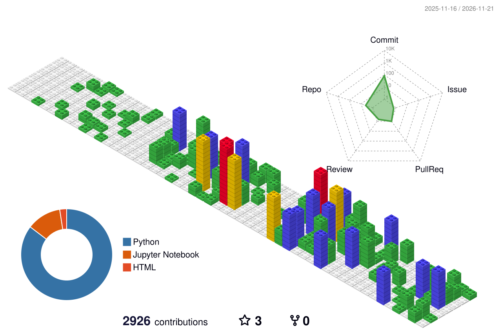

## Hi, I'm Lucas 👋

**Senior Data Engineer** at BAS World in the Netherlands. I build data platforms that people depend on.

- 🔥 Spent five years at **INPE** (Brazil's National Institute for Space Research) on the national fire monitoring program: ETL pipelines over 200+ million records, feeding Civil Defense and environmental agencies across Brazil.
- ☁️ Today I build event-driven pipelines on **AWS** (Lambda, Step Functions, Glue, Redshift) with **Airbyte**, **Dagster** and **Terraform**, and contribute to the team's **dbt** models.
- 🤖 I build with AI every day: I design the system and drive implementation with **Claude agents**, **MCP integrations** and **Lovable**.
- 🎮 Creator of **[The Data Forge](https://thedataforge.dev)**, a gamified learning platform for data engineers (32 courses, 400+ hands-on exercises).
- 📚 Also a published sci-fi fantasy author, as L.S. Sandoval.

### Featured projects

| Project | What it is | Stack |
|---|---|---|
| **[Grontia](https://github.com/luk14236/grontia)** · [live](https://grontia-304a9d81f22f.herokuapp.com/) | Is this Dutch home fairly priced, and is the rent legal? End-to-end data platform on Dutch open data: medallion lake, 21 dbt models, 122 data-quality tests, near real-time traffic pipeline. | Airflow 3, PySpark, dbt, DuckDB/MotherDuck, FastAPI |
| **[Fire Hotspot Calendar](https://github.com/luk14236/space_apps_2026_team_teu)** · [live](https://luk14236-space-apps-teu-2026.hf.space/) | NASA Space Apps Challenge 2026 (Team TEU): 77M fire hotspots, MODIS/VIIRS harmonization and a situation room for fire response teams. | Python, Dash, Plotly, DuckDB, Docker |
| **[ITU AI & Space Computing Challenge](https://github.com/luk14236/ITU-challenge-fase2)** | Crop type and phenology classification from Sentinel-2 imagery. Reached Phase 2. | LightGBM, rasterio/GDAL, Docker |
| **[Queimadas news search](https://github.com/luk14236/queimadas-inpe-news-search)** | Tool to search and track media coverage of INPE's Fire Monitoring Team and wildfires in Brazil. | Python, MediaStack API |

### Stack

`Python` `SQL` `AWS` `Spark/PySpark` `dbt` `Dagster` `Airbyte` `Terraform` `Docker` `PostgreSQL/PostGIS` `DuckDB` `FastAPI` `Claude / MCP` `Lovable`

### Get in touch

[LinkedIn](https://www.linkedin.com/in/luk1/) · luk14236@gmail.com

